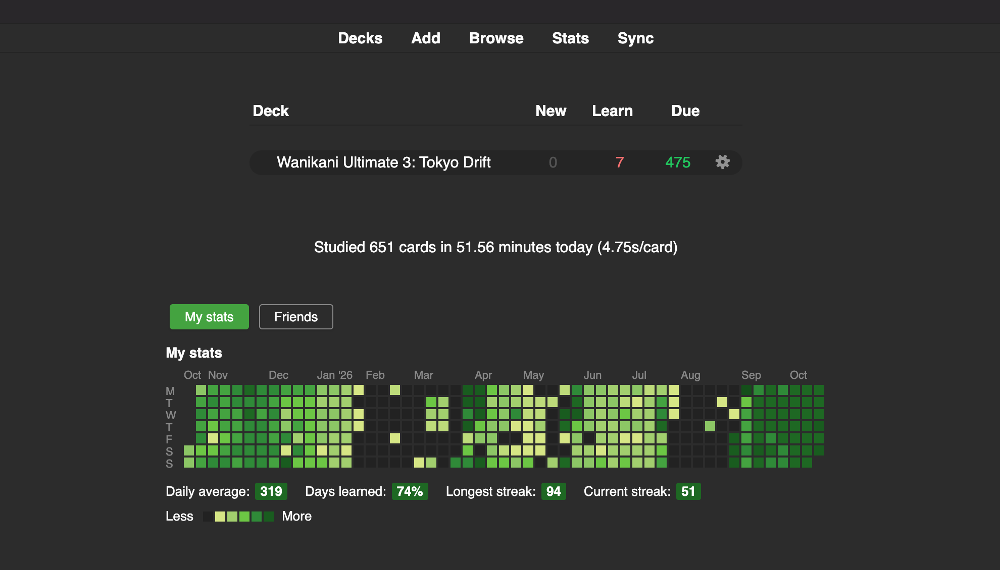
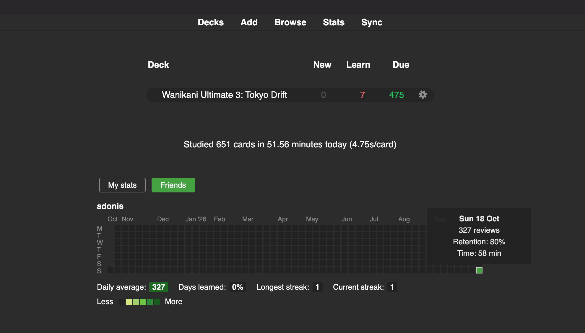
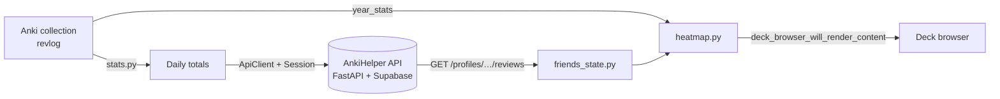

# AnkiHelperExtension


An Anki add-on that turns private study stats into a shared, social progress view. It reads review history from the local Anki collection, pushes daily totals to the AnkiHelper backend (FastAPI + Supabase), and draws a GitHub-style year heatmap of your reviews, and your friends', on Anki's deck browser.

> Backend: _link to the AnkiHelper backend repo here_ (separate repository). The add-on needs a running backend to sync.

## Screenshots

<!-- TODO: capture these and place them in docs/images/ -->
| My stats | Friends |
| --- | --- |
|  |  |


## How it works



**Daily push.** `stats.today_stats` reads the `revlog` table through Anki's collection API and computes review count, true retention (share of review-type answers that were not "Again") and study minutes. The study day follows Anki's "next day starts at" rollover (`col.sched.day_cutoff`) rather than midnight, and is dated from noon to avoid DST errors. `PUT /reviews/daily` sends the running total for the day, so it is an idempotent upsert and safe to repeat. Pushes fire after answering cards (throttled to once per 5 minutes), after a sync, when the profile closes, or manually from the Tools menu.

**Authentication.** Log in with the email and password from config and keep the tokens in memory only. Tokens are refreshed shortly before they expire. On a 401 the client refreshes once and retries once; if the refresh fails it logs in again. Refresh tokens rotate and are single use, so refreshes are single-flight: when several threads hit a 401 together, only one refresh is sent and the rest reuse its result.

**Friends and heatmaps.** Your own year is computed locally from `revlog`. Friends are fetched with `GET /profiles/{username}/reviews?days=365` for each name in the `friends` config list. They load lazily the first time the Friends tab is opened, refresh after 5 minutes, and while the server is down or waking up the add-on retries every 15 seconds. A failed background refresh keeps the previous data on screen. The heatmap is a Monday-first SVG grid with 10 colour levels scaled to each person's own data, plus daily average, days-learned %, longest and current streak, and a per-day tooltip.

## Engineering highlights

- **UI never blocks.** All network calls run through `mw.taskman.run_in_background`; workers use a config snapshot and never touch `mw`.
- **Resilient HTTP.** GET and PUT retry on network errors and 5xx with jittered exponential backoff; POST is never retried. Errors map to a typed hierarchy (`errors.py`: `AuthError`, `NetworkError`, `ServerError`, `ApiError`, …).
- **Validated boundaries.** Responses are parsed with pydantic models; settings are validated up front (https required except for localhost, username format, de-duplicated friends).
- **Secrets handled carefully.** Tokens live in memory only, the password is masked in `Settings.__repr__`, a logging filter redacts bearer tokens and credentials (and is tested), and packaging swaps in the example config so local credentials never ship. The add-on talks only to the AnkiHelper API, never to Supabase directly.
- **Testable design.** Logic lives in pure modules (`stats`, `heatmap`, `friends_state`, `session`); only `ui.py` imports `aqt`, and `addon/__init__.py` skips UI setup when Anki is absent so tests run in plain Python.
- **Matches Anki's runtime.** Python is pinned to 3.13 to match Anki's bundled interpreter, and runtime dependencies (`httpx`, `pydantic`) are vendored since Anki does not provide them.

## Setup

1. Copy `addon/config.example.json` to `addon/config.json` (git-ignored, so credentials stay local).
2. Edit `addon/config.json` (options below).
3. Install the vendored dependencies: `uv pip install --target addon/vendor --python 3.13 "httpx>=0.28.1" "pydantic>=2.14.1"`.
4. With Anki closed, link the add-on: `ln -s "$PWD/addon" ~/Library/Application\ Support/Anki2/addons21/ankihelper`.
5. In Anki, use Tools > AnkiHelper: Test connection. If you have no account yet, use Tools > AnkiHelper: Sign up.

| Option | Description |
| --- | --- |
| `base_url` | Backend URL. `https` required, except for `localhost`. |
| `email`, `password` | Account credentials. The password is stored in plain text in the config file, so keep it local. |
| `username` | 3-20 chars of `a-z0-9_`; used only by Sign up. |
| `friends` | Usernames whose last year of reviews is shown. There is no friends-list endpoint yet. |
| `timeout_seconds` | HTTP timeout (default 15). |
| `debug_logging` | Write a redacted rotating log to `addon/user_files/ankihelper.log`. |

### Tools menu

- **Test connection**: logs in and calls `GET /auth/me`.
- **Sign up**: prompts for a username and calls `POST /auth/signup`.
- **Push today's reviews**: `PUT /reviews/daily` (also runs automatically).
- **Refresh friends**: re-fetches each friend's reviews; unknown usernames are skipped.

### API endpoints used

| Endpoint | Used for |
| --- | --- |
| `POST /auth/signup` | Sign up (`{email, password, username}`) |
| `POST /auth/login`, `/auth/refresh`, `/auth/logout` | Session handling |
| `GET /auth/me` | Test connection |
| `PUT /reviews/daily` | Push today's running totals |
| `GET /profiles/{username}/reviews` | A friend's past year (404 if no such user) |

## Development

```sh
uv sync
uv run pytest        # 62 tests
uv run ruff check .
uv run pyright
scripts/package.sh   # builds dist/ankihelper.ankiaddon
```

Tests use a scriptable `httpx.MockTransport` backend (no network) and a real temporary Anki `Collection` for the stats queries. They cover login/refresh/retry behaviour including concurrent 401s, request retry rules, the stats calculations, heatmap rendering, the friends-loading state machine and log redaction. `ui.py` is not unit-tested because it needs a running Qt/Anki.

Packaging note: `pydantic_core` is a compiled wheel, so `.ankiaddon` builds are specific to the platform they were packaged on (currently macOS).

## Project layout

```
addon/
  __init__.py        entry point; adds vendor/ to sys.path, sets up UI inside Anki
  ui.py              menus, hooks, background tasks (only module importing aqt)
  api_client.py      HTTP client: retries, 401 handling, endpoint methods
  session.py         in-memory tokens, login/refresh, response checking
  stats.py           revlog -> daily and yearly stats
  heatmap.py         HTML/SVG/CSS/JS heatmap rendering
  friends_state.py   lazy-load / retry state machine for friends
  models.py          pydantic response models
  settings.py        validated config
  errors.py          exception hierarchy
  log.py             redacting rotating logger
tests/               pytest suite with fake transport and temp Collection
scripts/package.sh   builds the .ankiaddon
```

## Limitations and next steps

- Friends are configured by username; a friends-list endpoint on the backend would remove that.
- No CI yet.

## License

MIT. See `LICENSE`.
